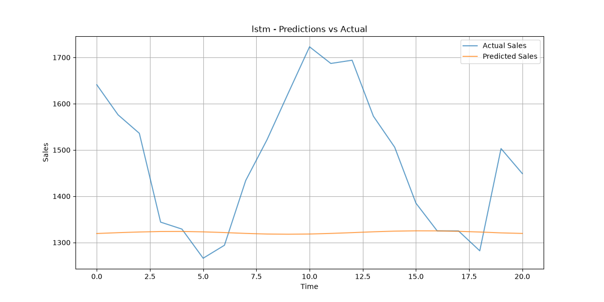
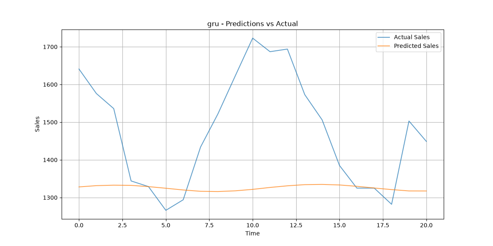

# Sales Forecasting · LSTM vs GRU 时间序列预测

对 Alcohol Sales 月度销量数据，用同一套数据管线与训练流程对比 **LSTM** 与 **GRU** 两种循环网络，并输出预测曲线、误差分布与训练曲线。

## 结果（测试集，指标在反归一化后的原始量纲上计算）

| 模型 | MSE | RMSE | MAE |
|---|---|---|---|
| LSTM | 45,440.43 | 213.17 | 167.24 |
| **GRU** | **43,695.14** | **209.03** | **163.49** |

> 同结构、同超参下 GRU 比 LSTM 收敛更快、测试误差更小，门控结构更简洁是这个数据集上的优势。





## 数据集

Alcohol Sales（月度，1992-01 ~ 2008-09），文件已随仓库提供：`data/Alcohol_Sales.csv`（也可从 [Kaggle](https://www.kaggle.com/datasets/bulentsiyah/for-simple-exercises-time-series-forecasting) 下载）。

## 快速开始

```bash
pip install -r requirements.txt
python main.py   # 训练 LSTM 与 GRU，评估并出图
```

## 目录结构

```
main.py              主流程：训练 + 评估 + 对比
src/data_loader.py   读取、缺失值处理、归一化、滑窗构造
src/models.py        LSTM / GRU 网络定义
src/train.py         训练循环与早停
src/evaluate.py      MSE / RMSE / MAE 与误差分布
src/utils.py         随机种子、设备、绘图
results/             权重、预测曲线、训练曲线、误差分布
课程设计报告_课题四_销售量预测.docx
```

## License

MIT
